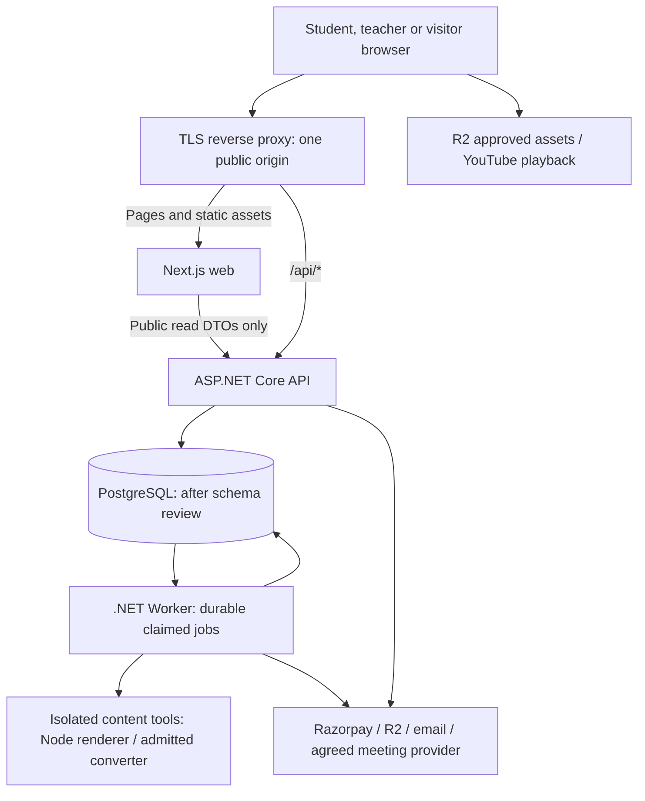

# Application architecture and foundation decisions

**Prepared:** 16 October 2026 · **Subphase:** 1.6 · **State:** Accepted through the owner's subsequent “go ahead”; implementation proceeds only in separately authorized leaves.

[Progress](../delivery/PROGRESS.md) · [Review](../delivery/reviews/1.6-architecture.md) · [API conventions](API-CONVENTIONS.md) · [Accepted authoring approach](../design/QUESTION-AUTHORING-DECISION.md)

## 1. Selected approach

Build one React/TypeScript application using **Next.js App Router**, backed by an **ASP.NET Core .NET 10 modular monolith with Clean Architecture**. PostgreSQL is the system of record after the mandatory schema review. Deploy the web frontend, API and background worker as separate processes with independent resource limits. Keep business rules and authorization in .NET. This gives public courses/blogs server-rendered pages, interactive student/staff screens and a manageable backend for the owner working with Codex.

This document records accepted architectural boundaries. It does not itself create projects, persistent entities, tables, migrations, provider accounts or infrastructure. Start those only in their named leaves. **At 2.4.1 ask for the previous database/table structure and target PostgreSQL details before dependent persistence work.**

| Decision | Selection and reason | Deferred detail |
|---|---|---|
| React framework | Next.js App Router, supported stable 16.x baseline at research time | Exact Next/React/TypeScript versions, compatibility and full lockfile admission in 2.1.1 |
| Frontend rendering | Public pages server-rendered; interactive islands for filters, lesson/quiz and staff tools | Route implementation and actual performance tests in their leaves |
| Backend | ASP.NET Core on .NET 10 LTS, feature-organized modular monolith | Current supported SDK/runtime patches and exact NuGet dependencies in 2.2.1 |
| Application shape | Domain, Application, Infrastructure, API; a separate Worker host when durable work is introduced | No persistent entities before 2.4.1–2.4.3 |
| Public routing | Same origin, `/api/*` routed to .NET and application pages/assets to Next | Host/domain/TLS provider, proxy configuration and limits at deployment setup |
| Browser authentication | ASP.NET Core Identity-managed cookies, API-issued antiforgery tokens, resource authorization | Identity stores/session policy in Phase 3 after schema approval |
| Database | PostgreSQL with compatible EF Core/Npgsql | Target version, topology, keys, indexes, tables and migrations after owner input |
| Long-running work | Durable PostgreSQL-backed work coordination and a separate .NET Worker | Exact queue/inbox/outbox representation and library decision after schema review; no new queue service by default |
| Formula validation | Shared reviewed TypeScript/JavaScript notation policy; bounded Node CLI in worker for publication checks | Shared package and protocol implementation during Phase 6 |
| DOCX conversion | Worker invokes an admitted pinned converter in isolation; Pandoc remains the preferred engine to prove | Exact binary/license/security/fidelity admission in 6.1.3, not approved by this architecture alone |
| UI styling | Existing semantic CSS tokens, system fonts and Light/Dark/System | Necessary accessible primitive packages reviewed in 2.1.3; no second competing styling system |

The [Next.js support policy](https://nextjs.org/support-policy) currently lists 16.x as Active LTS; select a supported stable patch again at installation. Its [server/client component model](https://nextjs.org/docs/app/getting-started/server-and-client-components) fits public rendering and interactive islands. Next.js is [MIT licensed](https://raw.githubusercontent.com/vercel/next.js/canary/license.md); self-hosting is supported, so no Vercel subscription is required by this choice.

The [Microsoft support table](https://dotnet.microsoft.com/en-us/platform/support/policy/dotnet-core) lists .NET 10 as LTS through 14 November 2028, with runtime patch 10.0.13 at lookup on 16 October. Local inspection found SDKs 9.0.308/10.0.103 and .NET/ASP.NET Core runtime 10.0.3: availability is not patch readiness. At 2.2.1 select/update and pin a supported SDK with its current patched runtime; do not confuse runtime patch numbers with SDK numbers. Node 24 LTS is the proposed runtime line for Next and the content tool, subject to supported-version and package checks at installation ([Node release table](https://nodejs.org/en/about/previous-releases)).

## 2. Requests and deployment topology



The browser calls relative `/api/v1/...` URLs. In local development a narrow Next rewrite forwards `/api/*` to a configured loopback .NET address; production routing belongs to the TLS reverse proxy, not a publicly accessible dynamic proxy endpoint. Preserve API path, cookies, status, antiforgery headers and request IDs. Only trust forwarded headers from known proxies; restrict hostnames and request sizes. .NET must receive the real HTTPS scheme for secure-cookie/redirect behavior. [Next self-hosting guidance](https://nextjs.org/docs/app/guides/self-hosting) recommends a reverse proxy; exact proxy software is a deployment admission decision.

Next Server Components request **public, published DTOs** from the API over a configured internal address. They do not read PostgreSQL or carry payment/storage secrets. Authenticated learner/staff data initially loads through the browser API client into private interactive screens. The shell can be server-rendered, but it must not embed private records or answer keys in shared HTML/RSC payloads. Next route groups and navigation checks are UI organization only; .NET protects every request. Private server rendering, if later required, needs a separate reviewed credential-forwarding/cache design.

Next Server Actions/Route Handlers do not become an alternative business backend. No duplicate enrollment, grading, pricing, payment verification, login store or direct EF/database access there. Normal public assets can be cached; authenticated API responses, preview/draft content and private page responses use `Cache-Control: no-store`. Public document routes initially use explicit no-store data reads to keep publication behavior simple; hashed static assets may be cached. Add public content caching/revalidation only with tested publication/withdrawal invalidation. Multiple Next replicas need cache/version coordination before enabling shared page caching.

### Deployment and environment policy

- Plan self-hostable Linux containers/processes for Next, API and Worker; managed PostgreSQL is a preferred production option to compare, not a purchased provider or promise of a free database. Initial staging can use one host with separate process/container limits. A single host is not high availability.
- Web/API/worker/DB and R2 namespaces, Razorpay test/live keys, email destinations and secrets are separated by environment. Test imports cannot charge, send bulk messages or expose production documents.
- Local Windows development uses Node/.NET directly; a container engine is optional tooling, not a mandatory paid desktop license. No Docker Desktop subscription, hosting plan or new service is selected here.
- Keep runtime secrets in local user secrets/environment or a reviewed production secret store. Only genuinely public configuration can enter `NEXT_PUBLIC_*`. Do not log cookies, tokens, raw question documents, payment secrets or student answers by default.
- PostgreSQL and workers have no public inbound ports. Only the reverse proxy is publicly reachable; health/OpenAPI/operations access is restricted appropriately. R2 credentials stay server-side; YouTube embeds still need the separately reviewed access/provider behavior.
- Protect and persist ASP.NET Core Data Protection keys; share the protected key ring/application identifier across API replicas when scaling. Lost or different keys can invalidate cookies. Choose an encrypted persistent/shared store and permissions in deployment setup, with key backup and rotation ([Microsoft configuration guidance](https://learn.microsoft.com/en-us/aspnet/core/security/data-protection/configuration/overview?view=aspnetcore-10.0)).
- Keep DB backups/restores, object retention, secrets/key recovery, deployment rollback and monitoring in the operations checklist. Infrastructure sizing, provider selection, recovery objectives and monthly budget remain open; no resources are provisioned by this document.

## 3. Frontend structure and dependency rules

The proposed production tree is documentation only; create it incrementally beginning with 2.1.1.

```text
apps/web/
  src/app/                   Route composition, layouts, loading/error boundaries
    (public)/                Home, catalog, course/blog detail
    (auth)/                  Login/recovery/verification screens
    (student)/               Dashboard, lessons, attempts, orders, classes
    (staff)/                 Assigned teaching and administrative workspaces
  src/features/<feature>/    Feature UI, hooks, local types and request functions
  src/components/ui/        Reused accessible visual primitives
  src/components/layout/    Shared public/student/staff layout pieces
  src/lib/api/              Fetch, cancellation, antiforgery, errors and contracts
  src/lib/                  Shared utilities with an actual cross-feature use
  src/styles/               Reset, theme tokens, base typography and global CSS
  src/types/generated/      API-generated types once OpenAPI exists
packages/question-content/  Later: shared notation/schema/render policy, not entities
```

Routes compose features; features may use shared primitives/utilities. Shared code must not import feature routes. Prefer explicit public exports rather than reaching into another feature's internals. Keep a type local until reuse is real. The public API DTOs are not database entities. Generated types replace provisional mocks when the relevant endpoint exists; they do not generate the backend schema.

Use built-in `fetch`, abort signals and ordinary React state first. Do not add a global state manager, request library, form library, UI suite or CSS framework without a concrete need and license/security review. Keep quiz answer state scoped to the attempt; do not retain another student's cached state after logout/account switching. Show confirmed server save status separately from local edits and pending requests.

Light/Dark/System tokens and mobile behavior remain the accepted design baseline. Theme initialization/hydration and persistence belong to 2.1.2; shared forms/dialogs to 2.1.3; responsive shells to 2.1.4. Formula editors and staff code are lazy-loaded only on authoring routes; students receive the approved read-only renderer/content, not Tiptap/MathLive bundles.

## 4. Backend project and feature boundaries

```text
src/GDTutor.Domain/          Pure business concepts/rules; eventual entities after gate
src/GDTutor.Application/     Use cases, DTOs, validation and capability interfaces
src/GDTutor.Infrastructure/  Persistence and external/tool adapters
src/GDTutor.Api/             Controllers, auth/policies, middleware and composition
src/GDTutor.Worker/          Durable job host, added when needed
tests/                      Focused domain, integration, browser and load checks
tools/migration/             Offline import/reconciliation commands
infra/                      Reviewed deployment/environment definitions
```

| Project | Allowed project references | Must not own |
|---|---|---|
| Domain | None | EF, ASP.NET, provider SDKs, HTTP, filesystem or job-host code |
| Application | Domain | Controllers, concrete database/provider clients, Next.js concerns |
| Infrastructure | Application and Domain | HTTP route policy or authoritative UI behavior |
| API | Application and Infrastructure; Domain only if genuinely needed | Business-rule duplication or controller-owned persistence queries |
| Worker | Application and Infrastructure | Direct internet-facing endpoints or an independent copy of business rules |

Infrastructure implements narrow capability interfaces owned by Application. API/Worker reference it to compose dependencies; use cases do not depend on concrete adapters. Avoid an interface for every class, generic repository wrappers around every EF operation, a mediator package, event bus or mapping package by default. Use explicit request/response mappings and normal application services. Microsoft describes the dependency inversion principles behind this structure in [Clean Architecture guidance](https://learn.microsoft.com/en-us/dotnet/architecture/modern-web-apps-azure/common-web-application-architectures).

Organize code by features within those projects: Accounts/Permissions; Catalog/Content; Enrollment/Learning; Questions/Assessments; Commerce; Classes; Community/Completion; Reporting/Operations. These are logical modules in one backend and, after schema approval, one transactional database. Cross-feature use cases call explicit services; do not reach around ownership with arbitrary table updates. Do not create empty projects or speculative entities to make the tree look complete.

Select ASP.NET Core controllers with explicit DTOs, built-in dependency injection, configuration validation, structured logging, exception-to-ProblemDetails middleware and OpenAPI. Use built-in DataAnnotations/simple explicit validators initially; add a separate validation package only if justified. Controllers handle HTTP and delegate use cases. API authentication/authorization policies are enforced again at each relevant use case/resource boundary, including ownership and current entitlement. Read models expose only intended fields; staff-only answer keys never enter student serialization.

## 5. Authentication and request trust

.NET owns registration, login/logout, recovery, verification, cookie issuance, security stamps, roles and resource permissions. Use Identity with secure HttpOnly host-only browser cookies; production cookie path is scoped to `/api`, with `SameSite=Lax` and `Secure`. Use a distinct development configuration on loopback; do not downgrade production settings. There is no browser-localStorage bearer token or separate Next auth database.

API issues an antiforgery request token through a same-origin endpoint, returned in JSON for the frontend to hold in memory. Authenticated cookie writes send it in `X-CSRF-TOKEN`, paired with the server's antiforgery cookie. Protect login/logout and other applicable state-changing browser actions as well. Refresh tokens after sign-in/account changes; SameSite alone is not the entire CSRF defense. Webhooks use provider signature checks over the original bytes instead of a browser CSRF token. See [ASP.NET antiforgery guidance](https://learn.microsoft.com/en-us/aspnet/core/security/anti-request-forgery?view=aspnetcore-10.0).

Use relative same-origin browser calls; CORS is disabled by default. A future necessary cross-origin integration requires an explicit origin allowlist and credentials policy, never wildcard origins with credentials. Native mobile applications/external API clients are a separate auth design if later requested.

Return API 401/403 status responses rather than HTML login redirects; the frontend handles sign-in/forbidden UI. Protect draft/publish/refund/support operations with resource permissions and current server state, not just a role claim or hidden button. Session invalidation, staff hardening and permission-change behavior are verified in Phase 3. [Cookie documentation](https://learn.microsoft.com/en-us/aspnet/core/security/authentication/cookie?view=aspnetcore-10.0) describes API behavior and protection mechanisms; configuration is not a tested login flow yet.

## 6. Durable work, exams and providers

The API owns short transactions and durable acceptance. Worker handles email, imports/conversion, scheduled work, reconciliation and exam deadlines without keeping a browser request open. Add the job host in the relevant authorized leaf; no job tables or queue schema are created now.

Select durable PostgreSQL-backed work coordination so crashes/restarts do not lose acknowledged work. Claim with leases, bounded retry/backoff, failure visibility and deduplication; coordinate multiple workers through shared state. Where a committed domain change requires later work, persist the work intent atomically with that change. Scheduling-library selection is deferred to 2.5.2 and must meet those guarantees; an in-memory task or Next request hook is not a durable queue. Heavy conversion concurrency is separately bounded from critical deadline/payment jobs, with reserved processing capacity or separate worker pools when measurements require it.

| Flow | Authoritative behavior |
|---|---|
| Answer save | Verify student/attempt ownership, deadline/state, version and idempotency; acknowledge only after durable commit. Local browser storage is recovery assistance, not proof of a saved answer |
| Deadline/submission | Persist an authoritative server deadline and attempt snapshot. User submit and worker timeout enter the same idempotent finalization use case; no process-local lock or browser timer is authoritative |
| Payment | .NET creates/prices orders and verifies Razorpay signatures. Durably record/deduplicate a verified event before acknowledging it; grant access from verified state with replay/reconciliation protection. Browser success is not payment proof |
| R2 images | .NET authorizes upload/finalization, validates metadata/content and safe object keys; approved assets served directly. A public image bucket is not private course-document authorization |
| Online/offline classes | .NET enforces configured membership/entitlement and hides private join details; meeting/email provider choices remain separate |
| Migration | Offline exports only, retained source IDs and reconciliation; no WordPress API/live DB/runtime. Import mode prevents payments and bulk notification side effects |

During exam reconnects, fetch server state/time and reconcile unacknowledged operations. Do not extend the deadline because a page was suspended, the clock changed or a worker ran late. At accepted course-expiry policy boundaries, valid active attempts follow the reviewed business rules; staff removal/fraud actions remain separate. These invariants guide future contracts, not implemented persistence.

## 7. Formula rendering and conversion boundary

The accepted 1.5.4 stack remains Tiptap OSS + MathLive + custom math nodes + KaTeX, with trusted bundled `mhchem` planned. Store source/structured content with a notation-profile version after schema approval; both teacher and student views use that policy. Unknown syntax remains visible for repair. Current preview source and package lock are untouched by this item.

To avoid asking .NET to interpret JavaScript renderer behavior independently, select a **small trusted Node CLI content tool**, invoked by the .NET Worker with structured input/output, timeout, resource limits and no network access. It loads only our versioned policy and admitted KaTeX assets; it never executes teacher scripts, arbitrary TeX compilers, Office automation or uploaded programs. Browser preview uses the same policy package. .NET independently checks authorization, schema, command/resource restrictions and limits before enqueueing.

Publication can be asynchronous: .NET records a draft version and validation request; the worker checks exactly that content/profile hash and reports diagnostics. The .NET use case publishes only if the checked version/hash still matches and all issues are resolved. A changed draft invalidates the earlier result. Do not trust a client-provided `validated=true`. Cacheable derived output must carry source/profile versions, and any stored HTML must pass the reviewed safe-render pipeline before serving.

DOCX import runs through the same isolated tools boundary using the separately admitted converter. Raw sources stay private; source inventory, diagnostics, missing-content reconciliation and manual region mapping are required. Heavy conversion never runs in the quiz request path. Office remains a local test target only; Pandoc is not installed/admitted by this architectural selection. See the [accepted scope and admission gates](../design/QUESTION-AUTHORING-DECISION.md).

This introduces no third network API or general-purpose Node business service. It does add a Node runtime/tool artifact to the content worker's eventual deployment, plus its own lockfile/notice scanning, memory/time limits and startup checks. Implement and prove that packaging in Phase 6; the API foundation must start without it.

## 8. Capacity, observability and release constraints

Design for the agreed **500 active students**, 180-minute exams and representative 200/250-question fixtures. This topology has no measured capacity yet. Use the existing [workload and pass thresholds](../requirements/DATA-MEDIA-AND-CAPACITY.md); test frontend formula performance and provider delivery separately from API/database capacity.

Keep API instances stateless with bounded connection pools/timeouts and paginated queries. API and Worker consume separate budgets within the database's overall connection limit; 500 students are not 500 dedicated database connections. Persist deadlines, idempotency, payment events and job coordination before scaling beyond one process. Instance-local counters/caches are not cluster-wide enforcement. Start with bounded per-instance API throttles plus edge limits; use durable use-case constraints for financial/attempt invariants and review distributed throttling if multiple replicas require a global limit.

Emit structured logs with request/trace identifiers, durations, safe error codes and job/import IDs. Track answer-save/submission latency and failures, DB pressure, deadline/job lag, conversion failure counts and payment reconciliation. Separate liveness from readiness; readiness checks only necessary dependencies with bounded timeouts. No student data or secrets in a public health response. Use built-in logging/health/OpenAPI facilities initially; any new telemetry backend or paid plan gets its own cost review.

Build once with reviewed lockfiles/artifact versions; promote verified artifacts to staging then production. Run dependency/license checks and targeted tests at their leaves. Rollouts need backward-compatible API/content changes, DB migration review after the schema gate, backups and rollback instructions. Never terminate active exams as an incidental deployment; test graceful drain/recovery and preserve durable attempts. Containers restarting must not imply reset timers or lost work.

## 9. Alternatives, unresolved choices and cost

A Vite SPA remains technically possible but would require a separate public rendering/SEO strategy. Select Next for the combined public/authenticated site. The Vite editor remains an isolated experiment, not the production scaffold. Microservices, Kubernetes, Redis, a message broker, a search cluster and a paid document service are not required by this baseline; revisit only when a measured constraint justifies one.

No package is installed or upgraded in 1.6. Next.js/React are MIT; ASP.NET Core/.NET use open-source licensing. Record exact package/tool images and notices, direct/transitive dependencies, peer compatibility and advisories at installation. Do not claim the earlier editor audit covers Next, a NuGet graph or the new content-tool package. EF/Npgsql admission follows the PostgreSQL review; new proxy/container/conversion tooling needs its own exact license check.

No new license purchase is required by these choices. Hosting/DB/backups, R2 usage, email, Razorpay processing and any meeting provider can incur operating charges; architecture does not choose a paid subscription. Select a hosting provider, budget, production sizing and recovery targets after requirements and measurements. The existing [six-week target and reforecast input](../planning/DELIVERY-BASELINE.md) remain conditional; no scope is dropped to fit it.

## 10. Implementation handoff and review gates

| Next authorized leaf, when approved | Deliverable and verification |
|---|---|
| 2.1.1 | Scaffold `apps/web` only, strict TypeScript, aliases, route/feature/shared boundaries, explicit scripts and package register; install supported audited versions, then verify lint/type/build. Use labelled placeholders, no production business entities |
| 2.1.2–2.1.5, each separately | Theme initialization, primitives, responsive shells, then API-client/error/form conventions with honest mocks |
| 2.2.1–2.2.3, each separately | Pinned supported .NET solution/project-reference graph, configuration/DI, then error/logging/health/OpenAPI conventions; no business persistence |
| 2.3.1–2.3.2, each separately | Actual same-origin web/API health/sample call and failure behavior, then reproducible checks/setup |
| 2.4.1 | **Ask owner for prior tables/database structure and target PostgreSQL details; review before entities/mappings/migrations** |
| 2.5.2 / Phase 6 | Durable worker coordination, shared content policy and isolated render/conversion packaging; test restart/version/failure paths |

Review acceptance examples: Next cannot grant access; .NET rejects a different student's attempt even if the route is guessed; private answer keys never enter public SSR/caches; stale saves cannot overwrite acknowledged new answers; worker restarts cannot erase accepted work; a changed draft cannot publish with an older validation result; two API instances must use compatible cookie keys and durable coordination. These are planned verification obligations, not passing runtime tests.

The owner accepted 1.6 and authorized **2.1.1** through the subsequent “go ahead.” Follow the progress tracker for that review. Do not scaffold the rest of Phase 2 automatically. Production provider selection and database input are not needed to finish this architecture review, but remain required at their named implementation gates.
