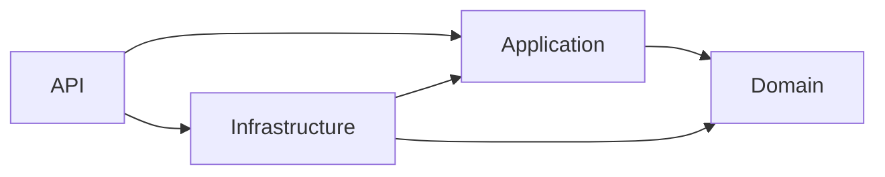

# Backend project foundation — 2.2.1

**Updated:** 16 October 2026 · **Status:** Accepted through owner “go ahead” on 16 October 2026  
[Review](../delivery/reviews/2.2.1-backend-scaffold.md) · [Progress](../delivery/PROGRESS.md) · [Toolchain admission](../reference/BACKEND-TOOLCHAIN.json)

## Structure and dependency direction

The solution contains exactly the four projects authorized by 2.2.1:

```text
GDTutor.slnx
Directory.Build.props
global.json
NuGet.Config
src/
  GDTutor.Domain/
  GDTutor.Application/
  GDTutor.Infrastructure/
  GDTutor.Api/
```



Domain is independent; Application references Domain; Infrastructure references Application/Domain; API references Application/Infrastructure. API has the implicit ASP.NET Core shared framework; the inner assemblies do not. The three library assemblies are intentionally boundaries with no business types in this scaffold. This avoids inventing entities or adding fake interfaces just to populate folders. Feature folders will appear with real authorized work.

The minimal API Program creates and runs the ASP.NET Core host and maps no endpoints. HTTP 404 is expected at `/` and `/api/v1/system/status`. It is not a health endpoint or proof of frontend/API integration. Controllers, health, ProblemDetails, logging policy and OpenAPI belong to 2.2.3; service interfaces, DI and validated environment configuration belong to 2.2.2. Worker, EF/Npgsql and provider SDKs are not created here.

## SDK, compiler and restore policy

`global.json` requires SDK 10.0.402 with rollForward disabled and prereleases excluded. The official [release metadata](https://builds.dotnet.microsoft.com/dotnet/release-metadata/10.0/releases.json) identifies its .NET/ASP.NET Core runtime as 10.0.13, released 13 October 2026. Selection and the Windows x64 SHA-512 archive checksum are recorded in the admission register. The original machine SDK 10.0.103 remains unchanged; the verified portable SDK is ignored under `.planning-review/dotnet`.

The projects target net10.0/C# 14 with nullable references, implicit usings, built-in analyzers, deterministic output and warnings as errors. API publish is framework-dependent with UseAppHost=false and requires runtime 10.0.13 or a newer 10.0 patch through LatestPatch. SDK pinning and runtime patch roll-forward are distinct. Update the admission/pin together during future maintenance; this is a dated snapshot, not a claim the patch stays current indefinitely.

Only the official NuGet v3 source is configured; user/machine package sources are cleared. Package lockfiles are retained for all four projects. No explicit/transitive NuGet library is added. NuGet audit is enabled for all severities/dependencies, but a zero-package graph does not audit the runtime/shared framework or certify security. Runtime patch admission is checked separately against Microsoft release metadata. Built-in framework packs are SDK components, not application PackageReferences.

.NET source is MIT; Microsoft’s Windows product distribution uses the [.NET Library License](https://dotnet.microsoft.com/en-us/dotnet_library_license.htm) and bundled third-party notices. See the upstream [license explanation](https://github.com/dotnet/core/blob/main/license-information.md). The Windows development SDK is not inaccurately recorded as an MIT-only binary. No paid package/tool/service is selected. Production Linux runtime packaging/notices will be reviewed with deployment rather than copying this Windows archive into production.

## Local commands

From the repository root in PowerShell:

```powershell
# Only when the exact SDK is not installed locally/on the machine:
./tools/backend/Install-LocalSdk.ps1

./tools/backend/dotnet.ps1 --version
./tools/backend/dotnet.ps1 restore GDTutor.slnx --locked-mode
./tools/backend/dotnet.ps1 build GDTutor.slnx -c Release --no-restore
./tools/backend/dotnet.ps1 format GDTutor.slnx --verify-no-changes --no-restore
./tools/backend/Verify-Architecture.ps1
./tools/backend/dotnet.ps1 run --project src/GDTutor.Api
```

The wrapper selects the project-local SDK first or the exact installed SDK, validates the pin, and keeps CLI/NuGet caches ignored in this workspace. It opts out of CLI telemetry and development-certificate generation; it does not install a machine-wide SDK or trust certificates. The bootstrap only extracts a matching official archive after SHA-512 verification and refuses to overwrite an existing SDK directory. On non-Windows/x64, use the official exact-version SDK for that platform; the bootstrap is intentionally Windows-specific. Run the wrapper from the repository; it establishes the root working directory for consistent SDK/config selection.

The dev launch profile also uses loopback 5080 and launchBrowser=false. To repeat the startup check, publish with `./tools/backend/dotnet.ps1 publish src/GDTutor.Api/GDTutor.Api.csproj -c Release --no-restore -o .planning-review/backend/publish`, then run `./tools/backend/Verify-Startup.ps1`. It refuses an occupied port 5081, starts on loopback and stops its own process. No backend server is kept running by scaffold verification. Port 3000/frontend previews remain independent. Production origin/HTTPS/secrets, frontend proxy wiring and real API request acceptance are future leaves.

## Verification and boundary

[Foundation evidence](BACKEND-FOUNDATION-CHECKS.json) records nine passing observations: verified SDK, locked restore, zero-warning Release build, formatting, inward references, empty NuGet graph/audit, framework-dependent publish, loopback startup/404s/process cleanup and no unauthorized business types. [Architecture checks](BACKEND-ARCHITECTURE-CHECKS.json) retain source hashes; [startup evidence](BACKEND-STARTUP-CHECKS.json) retains runtime configuration and assembly/script hashes. `Verify-Architecture.ps1` checks declared inward references, evaluated restored assets, lockfiles, four solution members and the absence of unauthorized business/service source in this specific leaf. This foundation-only guard must evolve when later authorized services/features are added; it is not a permanent ban on application code.

Database input remains mandatory at **2.4.1** before persistent entities, tables, EF mappings or migrations. No PostgreSQL connection or production data is required for these project boundaries. Next proposed leaf is 2.2.2, after this scaffold review. Backend capacity, authorization and application readiness are not established by a successful empty-host smoke check.

## Following checkpoint

This document and its 2.2.1 evidence preserve the accepted empty-project snapshot. Current services/configuration behavior is documented separately in [2.2.2](BACKEND-SERVICES-CONFIGURATION.md); follow the tracker for its review. The current architecture guard evolves with the authorized source list.
