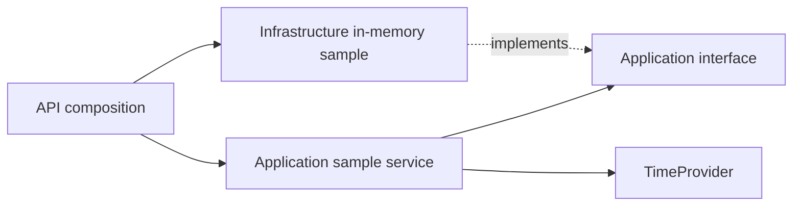

# Backend services and configuration — 2.2.2

**Updated:** 16 October 2026 · **Status:** Accepted on 17 October 2026  
[Review](../delivery/reviews/2.2.2-services-configuration.md) · [Progress](../delivery/PROGRESS.md) · [Dependency record](../reference/BACKEND-SERVICE-DEPENDENCIES.json)

This guide records the accepted 2.2.2 snapshot. The [2.2.3 HTTP guide](BACKEND-HTTP-FOUNDATION.md) describes the current host, package graph and verification tools; the historical no-endpoint/zero-package evidence below is preserved.

## Result and boundary

Application owns a narrow `IFoundationSampleSource` port, a concrete `FoundationSampleService` and a nonpersistent sample result. Infrastructure implements the port with an immutable in-memory label. API owns composition and configuration validation. The service consumes `TimeProvider` for UTC time; it has no dependency on ASP.NET, DI/Options packages, database code or a provider SDK.

The result is explicitly marked IsDemonstration. It is a wiring example, not a course/student entity, provider readiness result, durable save or business service. The API still maps no endpoints; HTTP/error/health/OpenAPI work belongs to 2.2.3. Frontend/API integration is 2.3.1. PostgreSQL structure input is still mandatory at 2.4.1 before persistent definitions.



## Composition and lifetimes

`BackendServices.AddBackendFoundation` registers:

| Dependency | Lifetime | Reason |
|---|---|---|
| FoundationSampleService | Scoped | Per-request/application operation instance; no cross-request state |
| IFoundationSampleSource | Singleton | Immutable, stateless in-memory label; no I/O |
| TimeProvider | Singleton | Built-in System clock; replaceable in tests |
| Options validator | Singleton | Checks typed settings against the host environment |

TryAdd registrations allow a caller/test to supply another adapter or clock before composition or replace them explicitly. The service itself remains unchanged. No interface is added for every concrete class, and no repository/mediator/mapping framework is introduced. API enables ValidateScopes and ValidateOnBuild in every environment. Root resolution of scoped services and singleton capture of a scoped dependency are rejected. Registration factories are additionally exercised by the harness because ValidateOnBuild alone does not execute factory bodies.

## Typed environment settings

ApplicationOptions contains configuration only:

| Key | Validation/use |
|---|---|
| Application:DisplayName | Required, maximum 80 characters; used by the in-memory sample label |
| Application:PublicOrigin | Required origin with no credentials/path/query/fragment; HTTPS outside Development; HTTP only for loopback in Development |
| Application:DefaultTimeZone | Required, bounded to 100 characters and recognized by TimeZoneInfo; default Asia/Kolkata |

The public origin is parsed/validated only. It is not contacted, added as a CORS policy or treated as authentication. These settings do not define a database schema or production hosting selection. Unknown Application keys are rejected rather than silently ignored. Binding errors are converted to a safe OptionsValidationException. Data annotations and the environment-aware validator run through ValidateOnStart.

The API catches options validation failure, prints a generic configuration message and exits with code 78. The real startup check verifies that it never listens and does not echo the rejected credential-like fixture. Other API exception/logging conventions remain 2.2.3; this is not a general log-redaction certification.

Base appsettings.json contains DisplayName/default timezone and a deliberately blank PublicOrigin. appsettings.Development.json supplies http://127.0.0.1:3000. Therefore the normal Development launch profile starts locally, while Production/Staging require an explicit valid public origin. There is no fallback production URL or real credential in source.

WebApplication.CreateBuilder retains the standard provider precedence: base JSON, environment JSON, Development user secrets when available, environment variables, then command-line values. UserSecretsId is present, but no credential is required, provided or written by this leaf; verification uses synthetic non-secret settings. Environment variables use double underscores, for example Application__PublicOrigin. Future database/provider credentials must use reviewed secret configuration rather than committed JSON.

The bound application options and singleton adapter label are a startup snapshot. Restart after changing these settings; live options/provider replacement is not an operational feature. All adapters remain clearly labelled samples, even with Production configuration. No production capability is implied by successfully booting this foundation.

## Reproduce the review

From the repository root in PowerShell, using the admitted SDK wrapper:

```powershell
./tools/backend/dotnet.ps1 restore GDTutor.slnx --locked-mode
./tools/backend/dotnet.ps1 build GDTutor.slnx -c Release --no-restore
./tools/backend/dotnet.ps1 run --project tests/GDTutor.FoundationChecks -c Release --no-build --no-restore
./tools/backend/dotnet.ps1 format GDTutor.slnx --verify-no-changes --no-restore
./tools/backend/Verify-Architecture.ps1
./tools/backend/dotnet.ps1 publish src/GDTutor.Api/GDTutor.Api.csproj -c Release --no-restore -o .planning-review/backend/publish
./tools/backend/Verify-Startup.ps1
```

The console check harness uses only the existing shared framework, not a new test package. It reports JSON and a nonzero exit on failure. It starts real Generic Hosts without opening sockets, and tests the actual production registration/validation code. There are four production projects plus this one verification project in the solution.

For the local API, run `./tools/backend/dotnet.ps1 run --project src/GDTutor.Api`; its Development profile uses loopback 5080. To try Production locally without changing files, set ASPNETCORE_ENVIRONMENT=Production, Application__PublicOrigin=https://preview.example.test and ASPNETCORE_URLS=http://127.0.0.1:5080 in the current shell, then run the same command with --no-launch-profile. The sample origin is a reserved example, not a deployed site. Restore those shell variables after the example. No host is left running by verification.

## Evidence

- [21 service/DI/options checks](BACKEND-SERVICE-CHECKS.json) pass: replacement adapters/clock, explicit lifetimes, root/captive-scope rejection, cancellation before/after an adapter, valid and missing/invalid settings, HTTPS/environment rules, unknown keys, precedence and sanitized validation failures.
- [Published startup](BACKEND-SERVICE-STARTUP-CHECKS.json) passes three cases: Development JSON, Production environment override and invalid Production configuration exiting with 78. Valid cases listen only on loopback and still return expected 404s; all processes stop.
- [Architecture checks](BACKEND-SERVICE-ARCHITECTURE-CHECKS.json) verify unchanged inward production references, the extra verification project, zero restored NuGet packages, lockfiles and the explicit foundation-only source list.
- Locked restore, zero-warning/error Release build, format verification and framework-dependent publish pass. The SDK/runtime admission is unchanged; no new dependency/tool/service cost is introduced.

The original 2.2.1 reports remain historical snapshots and are not overwritten by these service reports. The architecture guard evolves per authorized leaf rather than forbidding all future service code. No UI change, database/provider call, HTTP business operation, authentication or 500-student capacity guarantee is included.

Primary references: [Microsoft options validation](https://learn.microsoft.com/en-us/aspnet/core/fundamentals/configuration/options?view=aspnetcore-10.0) and [DI lifetimes/scope validation](https://learn.microsoft.com/en-us/dotnet/core/extensions/dependency-injection/overview). Next proposed leaf is **2.2.3 — HTTP conventions, errors, logging, health and OpenAPI**, after this review.
